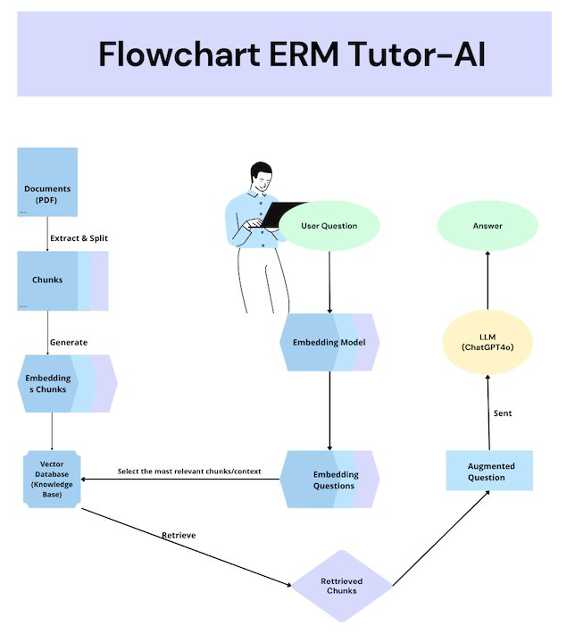
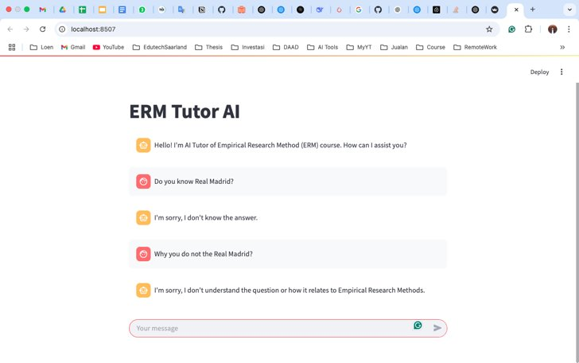
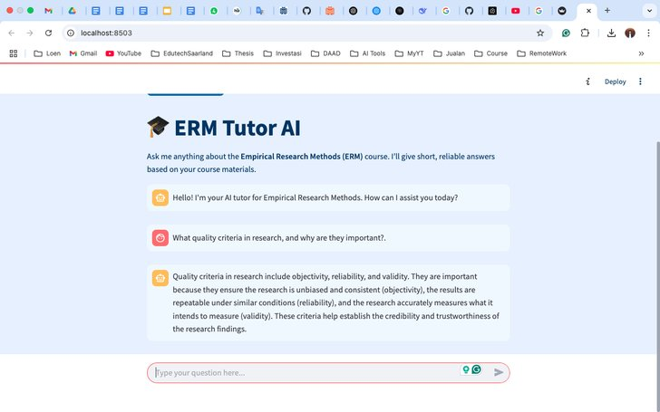
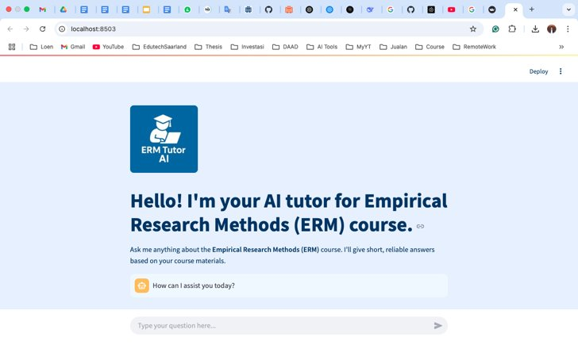
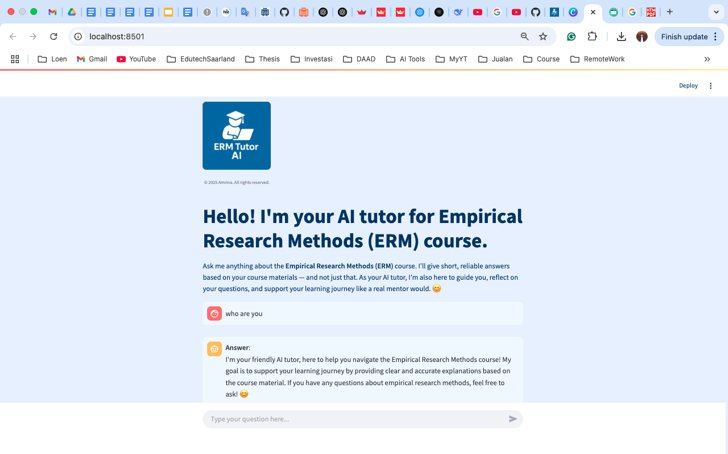

<p align="center"></p>

# ERM Tutor-AI: a RAG-based tutor for Empirical Research Methods

**Master's thesis project · M.Sc. Educational Technology · Saarland University**
Amrina · Supervisors: Dominik Thüs and Dr. Sarah Malone

🌐 **Project page:** https://sayamrina.github.io/ERM_TutorAI_v4/ · 🚀 **Live app:** https://erm-tutorai.streamlit.app/

ERM Tutor-AI is a web-based chatbot tutor for students in the *Empirical Research Methods* (ERM) course. It combines a large language model (GPT-4o) with **Retrieval-Augmented Generation (RAG)**: before answering, it retrieves passages from the official course materials, so its answers stay grounded in what is taught. It also shows students where an answer came from, and it behaves like a tutor rather than a search engine.

In a comparison on 20 course questions, two course instructors rated ERM Tutor-AI's answers **6.75 / 7** on average, against **6.00 / 7** for ChatGPT-4o. ERM Tutor-AI's answers were also about 30% shorter.

---

## Why

LLMs can produce answers that sound right but are wrong ("hallucinations"). In a methods course, a confident but incorrect explanation of a p-value or an ANOVA can do real damage to learning. ERM Tutor-AI addresses this by grounding every answer in the course's own lecture materials and by making the source visible to the student.

## What it does

- **Grounded answers.** Retrieves the most relevant chunks from 12 ERM lecture units (from basics and experimental design to t-test, ANOVA, MANOVA, regression, non-parametric tests and bias in research) and answers from them first.
- **Shows its source.** Every answer is labelled with where it comes from: *Course Materials: <unit>*, or *General Academic & Research Methodology Knowledge* when the course materials do not cover it.
- **Tutor behaviour.** Answers include a short empathetic reflection, the explanation and a follow-up question, written as one natural reply.
- **Stays on topic.** Questions unrelated to research methods are politely declined.
- **Concise.** Each answer displays its word count; the tutor aims for focused rather than exhaustive replies.

## How it works

<p align="center"></p>

1. **Indexing.** The course PDFs are converted to text with Markitdown, split into chunks (1,500 characters, 50 overlap) and embedded with `sentence-transformers/all-mpnet-base-v2`. The vectors are stored in ChromaDB.
2. **Retrieval.** For each question, the 4 most relevant chunks are selected with maximal marginal relevance (MMR, from 10 candidates), which keeps the retrieved passages diverse.
3. **Generation.** GPT-4o (temperature 0) receives the question, the retrieved passages and a tutor prompt with clear priorities: course materials first, general ERM knowledge second, refusal for off-topic questions.
4. **Interface.** A Streamlit chat app displays the answer, its source and its length.

| Layer | Tools |
|---|---|
| Interface | Streamlit |
| LLM | OpenAI GPT-4o (API) |
| Orchestration | LangChain (RetrievalQA) |
| Vector store | ChromaDB |
| Embeddings | sentence-transformers (Hugging Face) |
| PDF parsing | Markitdown |

## Design process

The tutor was built with a design-based research approach in four interface iterations: from a minimal question–answer prototype, through clearer structure and prompt refinements, to a branded, user-centred interface with a short onboarding message.

| Version 1 | Version 2 | Version 3 | Version 4 (final) |
|---|---|---|---|
|  |  |  |  |

## Evaluation

- **Questions:** 20 representative questions from the weekly ERM assignments, covering all course units.
- **Systems:** ERM Tutor-AI vs. ChatGPT-4o as the baseline.
- **Raters:** two course instructors/tutors, using a 7-point rubric adapted from Lee (2024): accuracy, relevance, excessive or insufficient information, user perception, and tutoring behaviour.

| | ERM Tutor-AI | ChatGPT-4o |
|---|---|---|
| Mean rubric score (± SD), 40 ratings each | **6.75 ± 0.44** | 6.00 ± 0.76 |
| Mean answer length (words) | **198** | 280 |
| Median answer length (words) | 185 | 265 |

A two-way ANOVA showed a significant effect of the model (F(1, 76) ≈ 32.8, p < .001) and no significant effect of the instructor or of the interaction. ERM Tutor-AI's answers were rated higher and were more concise and more consistent in length.

## Limitations

- The evaluation used 20 questions and two raters. Inter-rater reliability was not reported, and the ratings were not blind to the system.
- One rater gave the maximum score to almost all ERM Tutor-AI answers, so ceiling effects are likely.
- There was no study with students yet, so effects on learning and engagement are unknown.
- The knowledge base is limited to the course materials, and the system was not compared with other architectures (e.g. fine-tuning or hybrid retrieval).

## Next steps

A study with students (learning gains, engagement, trust), a broader knowledge base, citations at passage level, and adaptive feedback based on what each student already knows.

## Run it locally

```bash
git clone https://github.com/sayamrina/ERM_TutorAI_v4.git
cd ERM_TutorAI_v4
pip install -r requirements.txt
export OPENAI_API_KEY=...          # your own key
streamlit run src/streamlitMain.py
```

On the first run, the vector database is built from the PDFs in `src/materials/`.

## Repository structure

```text
src/
  streamlitMain.py    Streamlit interface (chat, source labels, word count)
  RAG_ChatBot.py      RAG pipeline: parsing, chunking, embeddings, retrieval, prompt, GPT-4o
  materials/          ERM course PDFs used as the knowledge base
chroma_db/            vector database (built on first run)
docs/                 project page (GitHub Pages)
```

## Author

**Amrina** · [LinkedIn](https://www.linkedin.com/in/amrina-ali-487025119/) · [GitHub](https://github.com/sayamrina)

© 2025–2026 Amrina. All rights reserved.
